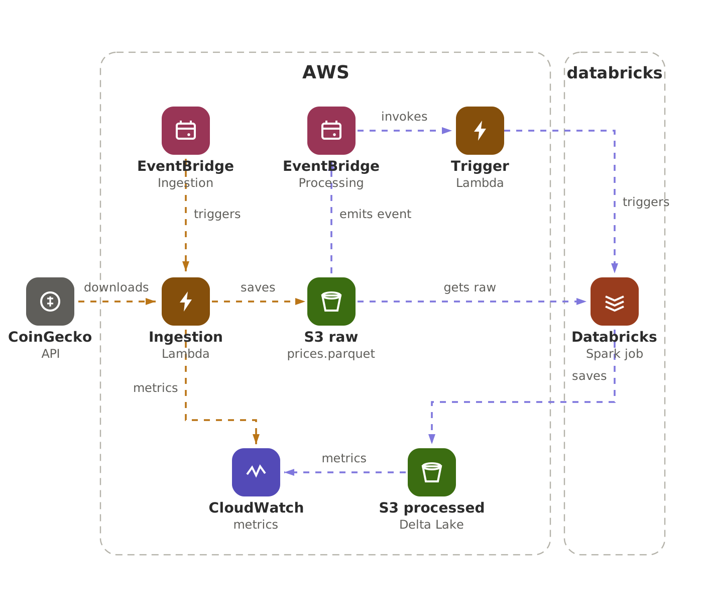

# 🪙 Crypto Lakehouse — Serverless Data Pipeline on AWS + Databricks

An event-driven, serverless data engineering project built in public. Live
crypto prices are ingested by a Lambda, landed in S3 as Parquet, and processed
by a Databricks Spark job into a **Delta Lake** star schema — with EventBridge
driving the flow and CloudWatch watching it.



> **Why this project?** It demonstrates the exact skills modern cloud data teams
> hire for: serverless ingestion, event-driven orchestration, a data lakehouse,
> Spark, Delta Lake, and infrastructure as code — all deployable from one repo.

---

## 🏗️ How it works

1. **EventBridge (schedule)** fires on an interval → invokes the **Ingestion Lambda**.
2. **Ingestion Lambda** pulls prices from the **CoinGecko API** and writes
   `prices.parquet` to the **S3 raw bucket**, then emits a `RawPricesLanded` event.
3. That event matches an **EventBridge rule** → invokes the **Processing Trigger Lambda**.
4. **Processing Trigger Lambda** calls the **Databricks Jobs API** to run the Spark job.
5. **Databricks (Spark)** reads the raw Parquet and writes a modeled star schema
   to the **S3 processed bucket** as **Delta Lake** tables.
6. **CloudWatch** collects metrics from both Lambdas.

---

## 🧰 Tech stack

| Layer | Service |
|---|---|
| Source | CoinGecko API |
| Scheduling / events | Amazon EventBridge |
| Ingestion | AWS Lambda (Python) |
| Raw storage | Amazon S3 (Parquet) |
| Processing | Databricks + Apache Spark (PySpark) |
| Processed storage | Amazon S3 + Delta Lake |
| Observability | Amazon CloudWatch |
| Infrastructure as code | Terraform |
| CI | GitHub Actions |

---

## 📁 Repo structure

```
crypto-lakehouse/
├── lambdas/
│   ├── ingestion/            # fetches prices → S3 raw → emits event
│   └── processing_trigger/   # invokes the Databricks job
├── databricks/
│   └── notebooks/
│       └── process_crypto.py # PySpark → Delta Lake star schema
├── infra/                    # Terraform: S3, Lambda, EventBridge, IAM
├── docs/                     # architecture diagram
└── .github/workflows/ci.yml  # lint + terraform validate
```

---

## 🚀 Deploy

**Prerequisites:** an AWS account, Terraform ≥ 1.5, and a Databricks workspace
(the free Community Edition works for running the notebook manually; the
automated trigger needs Databricks on AWS).

```bash
# 1. Vendor Lambda deps and deploy the AWS infra
make build
cd infra
terraform init
terraform apply \
  -var="databricks_host=https://dbc-xxxx.cloud.databricks.com" \
  -var="databricks_job_id=123456"

# 2. Import databricks/notebooks/process_crypto.py into your workspace,
#    create a job from it, and set databricks_job_id above.
```

> **Cost note:** stays within the AWS Free Tier for a learning project
> (Lambda, S3, EventBridge, CloudWatch). Tear down with `make destroy`.

---

## 📊 Data model (Delta Lake, star schema)

- `fct_price_snapshots` — one row per coin per minute (avg/min/max price, volume, market cap)
- `dim_coin` — coin metadata

---

## 📅 Build-in-public series

1. Architecture + repo scaffold
2. Ingestion Lambda (CoinGecko → S3)
3. Terraform: S3 + IAM
4. EventBridge schedule wiring
5. Event-driven trigger (RawPricesLanded)
6. Processing Trigger Lambda + Databricks Jobs API
7. PySpark staging transform
8. Delta Lake write + star schema
9. CloudWatch metrics + dashboard
10. GitHub Actions CI + retrospective

---

## 📝 License

MIT.

*Built in public — follow the series on LinkedIn.*
